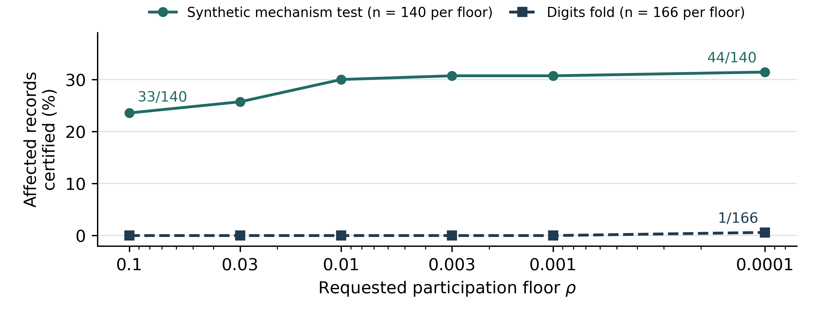

# Summary

Research objects such as documents and images often have several complementary descriptions. When one description becomes unavailable, a clustering algorithm may assign an object to a different group. BARG-CC is Python research software for investigating this uncertainty. It compares equal and reliability-dependent view weighting, simulates the loss of observations, and reports which assignments are mathematically guaranteed to persist under a specified audit and which merely remain unchanged in that experiment.

The review target is the offline numerical audit and batch workflow in BARG-CC Streamlit Studio V3.2 [@raystudio2026]. The execution evidence concerns a pinned public commit with two non-numerical fixes, not the hosted interfaces or other distributions.

# Statement of need

Multi-view clustering integrates heterogeneous representations of the same objects, some of which may be missing [@chao2021]. Researchers in unsupervised learning, document analysis and computational reliability need to distinguish changes caused by view loss from changes caused by model fitting. Internal clustering scores describe partition quality, but do not establish whether an individual assignment survives a prescribed perturbation. Repeated runs measure observed persistence without providing a sufficient mathematical condition for it.

BARG-CC addresses this gap by coupling controlled availability changes with representation displacement, a conditional stability certificate and empirical reassignment. Separate reporting for affected and unaffected records prevents high aggregate certificate coverage from obscuring weak guarantees on records that actually lose information. An uncertified assignment is not necessarily unstable. For example, a document analyst can investigate records that lose text or layout information and compare the certified subset with the empirically unchanged subset before choosing a fusion configuration.

# State of the field

Scikit-learn provides established preprocessing, clustering algorithms and evaluation metrics [@pedregosa2011]. The `mvlearn` package extends the estimator interface to multi-view learning, including clustering [@perry2021]; `polyview` describes composable multi-view embeddings, fusion and incomplete-view handling [@debaussart2026]. These packages provide broader learning infrastructure than BARG-CC, which is not intended to replace their estimators.

Rather than reimplement K-means [@lloyd1982] or propose another general-purpose estimator, BARG-CC builds on scikit-learn to coordinate a fixed reference geometry, a specified mask change, exact representation drift, centroid displacement bounds, reassignment and record-level evidence. A contribution limited to a fusion operator would leave investigators to implement these coupled checks, provenance and subgroup reporting themselves. Keeping the audit as a separate workflow also permits a headless test path and a shared evidence format without changing the underlying estimator. This is a comparison of research functionality, not evidence of superior clustering accuracy, runtime or generality.

# Software design

The numerical modules (`document_pipeline.py`, `hamv_gate.py`, `engine.py`) and batch driver (`run_batch.py`) are separated from the interface so the audit can be exercised without a hosted service. Figure 1 shows the shared reference partition, controlled perturbation and two distinct assessment branches. Disjoint normalized blocks avoid the need for learned cross-view alignment; holding embeddings and reliability scores fixed isolates the effect of availability. Refitting centroids once with fixed memberships sacrifices generality in exchange for a tractable guarantee and reproducible comparison.

{width="100%"}

## Bounded reliability gating

For record $i$ and view $v$, let $m_i^{(v)}\in\{0,1\}$ denote availability and $r_i^{(v)}\in[0,1]$ a reliability proxy, not a calibrated probability. All-missing records are rejected by the numerical layer and reported as unassignable by the document pipeline. The gate is

$$
w_i^{(v)}=\frac{m_i^{(v)}\exp[\kappa(2r_i^{(v)}-1)]}{\sum_u m_i^{(u)}\exp[\kappa(2r_i^{(u)}-1)]},\qquad \kappa\ge0.
$$

Uniform fusion corresponds to $\kappa=0$. With at most $M\ge2$ available views, the worst-case weight ratio is $e^{2\kappa}$; hence every available view has weight at least $\rho$ when $0<\rho\le 1/M$ and $\kappa\le\tfrac{1}{2}\log[(1/\rho-1)/(M-1)]$. This limits domination by any view without clipping or breaking normalization.

The fused representation is $z_i=\bigoplus_v\sqrt{w_i^{(v)}}\,\hat{x}_i^{(v)}$, where observed blocks are nonzero and unit-normalized and absent blocks are zero. Consequently $\|z_i\|_2=1$. The document workflow fits matched uniform and gated K-means partitions and selects the gated reference using silhouette scores [@rousseeuw1987]. The Research profile uses ten initializations and full silhouette evaluation; the Quick profile reduces computation but may select a different partition.

## Conditional view-loss certificate

The seeded perturbation removes one eligible observed view per selected record, retaining at least one. Let $q_i$ be its original weight (zero if unaffected). With embeddings, scores and $\kappa$ fixed, surviving weights renormalize by $1/(1-q_i)$. Since $z_i^\top z_i'=\sqrt{1-q_i}$, the displacement is exact:

$$
d_i=\|z_i'-z_i\|_2=\sqrt{2(1-\sqrt{1-q_i})}.
$$

For nonempty reference cluster $C_k$ with arithmetic-mean centroid $\mu_k$ and nearest-centroid-consistent labels $y_i$, a single fixed-membership refit has centroid displacement at most $B_k=|C_k|^{-1}\sum_{j\in C_k}d_j$. A sufficient margin is

$$
\ell_i=\min_{k\ne y_i}\left(\|z_i-\mu_k\|_2-\|z_i-\mu_{y_i}\|_2-2d_i-B_{y_i}-B_k\right).
$$

By the triangle inequality, a competing distance can decrease by at most $d_i+B_k$ and the assigned distance can increase by at most $d_i+B_{y_i}$. Therefore $\ell_i>0$ guarantees the same unique nearest centroid after the prescribed refit. The implementation checks nearest-centroid consistency and the drift identity, certifies at $\ell_i>10^{-10}$ and raises an error if a certified label changes. The condition is sufficient, not necessary. It does not certify unrestricted reclustering, changed reliability scores or retraining; fixed-mask and small-instance global-partition diagnostics have separate scopes.

## Reproducible evidence

The offline batch driver exports six CSVs and a JSON manifest. For example, the bundled mixed-document archive can be audited with `run_batch.py` using Research mode, seed 17, floor 0.1 and dropout 1 (all eligible records). The pointwise output records removed mass, exact and measured drift, certificate slack and both assignments. Coverage separates all, affected and unaffected records; the manifest identifies the input SHA-256, seed, settings and runtime environment. The source commit and patch are recorded separately. The reproduction guide supplies the complete command, expected outputs and environment.

A Streamlit interface provides an interactive route. The Agentic RAG companion uses retrieval [@lewis2020] for interpretation, not numerical decisions. The PyPI package `bargcc` 0.1.1 [@raybargcc2026] and Hugging Face workbench [@rayhf2026] are distinct distributions outside the tested scope.

**Software archives.** The authors supplied Zenodo identifiers for Studio [@studioarchive] (primary) and Agentic RAG [@ragarchive] (companion). These identify the intended archives for citation; release metadata and equivalence to the tested Studio commit plus patch remain to be verified. The RAG archive does not establish numerical parity.

# Research impact statement

BARG-CC implements diagnostics used in an associated unpublished study [@raydas2026]. Its archived Digits experiment (1,797 records, nominal 10% simulated dropout) certified 77.1% overall but none of the 189 affected records. That finding motivates subgroup reporting; the full experiment has not been independently rerun in this package.

**Software verification.** At public commit `a213cd6`, 37/38 archived regression tests passed; a missing Streamlit configuration caused one error. The batch manifest also failed to serialize a NumPy Boolean. Adding the configuration and casting the Boolean to a native type yielded 38/38 passes without numerical changes. Two mixed-document runs (seed 17, floor 0.1, Research profile) produced six byte-identical CSVs; manifest timings vary. The patch, logs, outputs and sweep script support reruns.

**Observed coverage.** Table 1 demonstrates why persistence and certification must be distinguished: 28/29 affected Digits assignments and 6/6 affected mixed-document assignments persisted, yet none was certified. Across 60 archived sweep runs, no false certificates were recorded and the largest drift-identity discrepancy was $4.8\times10^{-15}$. An output-level audit checked all 378 stored pointwise records, including the drift identity, reported slack threshold, label agreement and subgroup counts; all checks passed. It does not reconstruct centroid margins from the original embeddings.

| Run | Records | Affected | Certified (all) | Certified (affected) | Unchanged (affected) |
|:--------------------------|------:|------:|---------:|------------:|---------------:|
| Digits, archived | 1,797 | 189 | 77.1% | 0.0% | not rerun |
| Digits fold, seed 17 | 360 | 29 | 85.6% | 0/29 | 28/29 |
| Mixed documents, seed 17 | 18 | 6 | 66.7% | 0/6 | 6/6 |

Table: Certificate coverage and observed persistence under simulated view loss. Affected records lose one view; the mixed-document run perturbs every eligible record, and all 12 unaffected records were certified. The archived full Digits result is not a new execution. \label{tab:checks}

**Certificate sensitivity.** The 60-run sweep (six floors, five seeds, two datasets) tests when certification of affected records is possible. For synthetic data with three well-separated clusters, three views and one low-reliability view, pooled affected-record coverage rises from 33/140 (23.6%) at floor 0.1 to 44/140 (31.4%) at floor $10^{-4}$ ($\kappa=4.26$), with all affected assignments unchanged. The Digits fold, whose reliability scores vary little, certifies only one of 166 affected records at the lowest floor and none elsewhere (Figure 2). The synthetic case is a mechanism test; smaller participation floors can reduce removed weight mass but need not increase coverage. Counts are pooled repeated observations, not independent population estimates.

{width="100%"}

**Reference check and limits.** A separate NumPy/scikit-learn calculation tested 240 synthetic scenarios (11,520 record-instances): 5,805 certified, including 100 affected; 283 changed, none certified. This checks the equations, not the BARG-CC engine. Digits views derive from the same images; semantic accuracy, external adoption, hosted execution and cross-distribution parity remain unestablished. These results demonstrate diagnostic utility, not estimator superiority.

# AI usage disclosure

ChatGPT (OpenAI; GPT-6.2 for manuscript revisions, earlier versions unrecorded) assisted with software development, execution-error analysis, test preparation, documentation and manuscript editing. Earlier assistance included workflow illustration generation (OpenAI image model version unrecorded) and Figure 2 plotting. The latest author-supplied Figure 1 is incorporated without modification; its provenance remains for author confirmation. The revision history records Claude Sonnet 5.5 editorial assistance, which the authors must confirm along with the complete tool history.

Verification has included archived regression logs, pointwise CSV checks, figure consistency and a separate seeded reference calculation of the equations. ChatGPT also assisted with evidence checks, documentation, licensing and archive citation integration. The authors report reviewing earlier AI-assisted material; final human review, validation and responsibility for core design decisions require their explicit confirmation.

# Acknowledgements

The authors received no funding for this work.

# References
